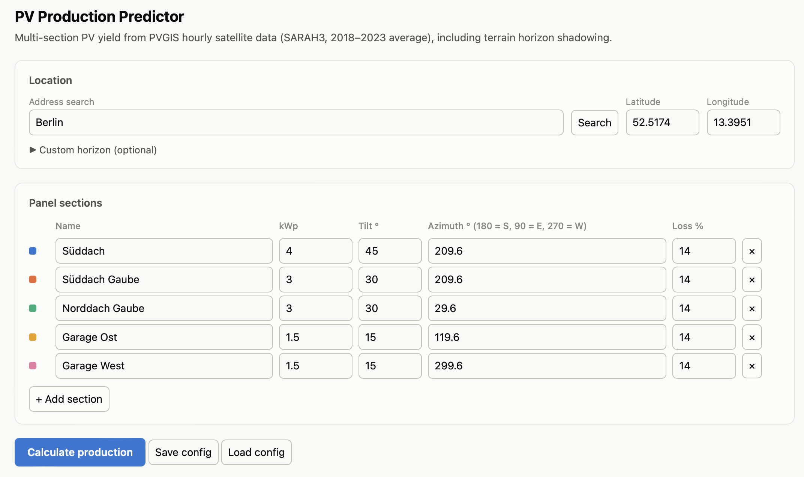
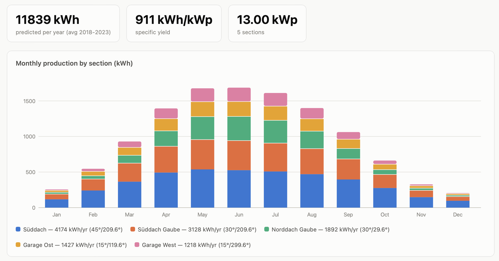
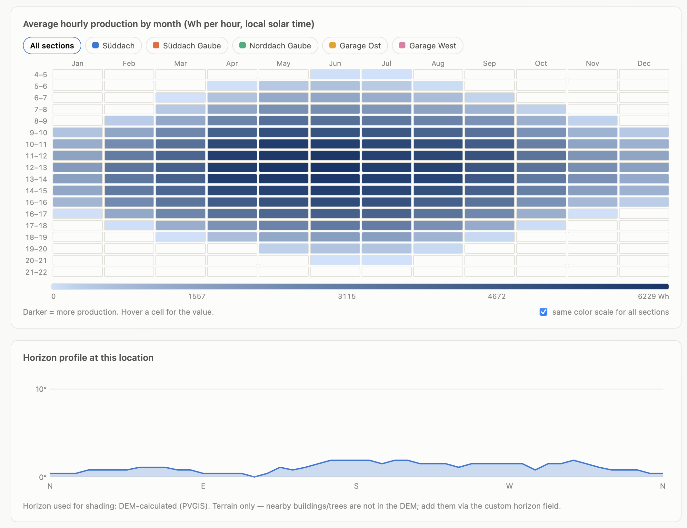

# PV production predictor

There are some very nice calculation tools for yearly/monthly/daily PV production, e.g.:
- https://globalsolaratlas.info
- https://re.jrc.ec.europa.eu/pvg_tools

However, none of them are able to create multiple sections with different azimuth, tilt etc. like it is the case for a complex house setup.

This simple web app lets you create these different sections, then fetch data from the PVGIS v5.3 API and display them nicely.

# Installation

Launch a local python webserver:
```python
pip install -r requirements.txt
python app.py
```

Then open the web app:
```
http://localhost:5001
```

## Static version (GitHub Pages)

`github-pages/` contains a server-less version that runs the calculation in the browser and reaches PVGIS through a small Cloudflare Worker. See [github-pages/README.md](github-pages/README.md) for deployment.

# Usage

An example config is stored in `configs/pv_config_example_Berlin.json`.

Search for your location and enter details about the PV system, like peak power, azimuth and tilt.



Then get the solar irradiation data and calculate monthly production, and daily profiles.

## How it is calculated

For each section, two small PVGIS calls (2005–2023 SARAH3 data, terrain horizon):

- `PVcalc` gives the average energy per month (kWh), including temperature, angle-of-incidence and spectral effects for the chosen PV technology and mounting.
- `DRcalc` gives the average daily irradiance profile per month on the panel plane.

Each month's daily profile is scaled so it adds up to that month's energy. Compared with summing 19 years of hourly `seriescalc` data (~15 MB per section), the hourly shares differ by under 0.5 percentage points, at ~25 KB per section.





Download the calculated data for further analysis as csv, and the PV config as json.

# Tests

```bash
pip install -r requirements-dev.txt
pytest                                 # Flask app + Flask/JS parity, offline (recorded PVGIS responses)
pytest -m live                         # same parity check against the live PVGIS API
node --test tests/worker.test.mjs      # Cloudflare Worker: origin/endpoint checks, caching
```

GitHub Actions runs the offline tests on every push and the live tests weekly (`.github/workflows/tests.yml`). After changing `tests/cases.json` or the PVGIS calls, re-record the responses with `python tests/record_fixtures.py`.

